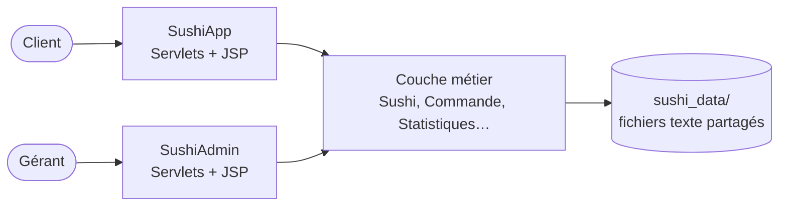

# Sushi : commande en ligne et gestion de restaurant

Application web Java EE pour un restaurant de sushis, composée de deux applications qui partagent les mêmes données :

- **SushiApp** : le site client (menu, commande en ligne, réservation de table, factures)
- **SushiAdmin** : le back-office du restaurant (catalogue, stocks, commandes, tableau de bord)

Projet universitaire réalisé à l'Université de Bordeaux.

## Fonctionnalités

### Site client (SushiApp)
- Menu avec photos et filtre par catégorie
- Commande en ligne avec choix du mode de livraison (sur place, à emporter, à domicile)
- Contrôle de disponibilité : plat en rupture désactivé, alerte « Plus que X » quand le stock est bas
- Réservation de table par créneau horaire
- Suivi de ses commandes et réservations
- **Facture** imprimable ou enregistrable en PDF

### Back-office (SushiAdmin)
- **Tableau de bord** : chiffre d'affaires total et du jour, panier moyen, articles vendus, top 5 des plats, commandes par statut, alertes de stock
- **Gestion des stocks** : stock par plat, sortie automatique à chaque commande, remise en stock en cas d'annulation, réapprovisionnement et seuil d'alerte
- **Commandes** : suivi du statut (en attente, en préparation, livrée, annulée), facture numérotée (`FAC-2026-0001`) avec TVA restauration à 10 %
- **Export CSV** des commandes, compatible Excel (montants HT, TVA, TTC)
- Gestion du catalogue de sushis, des recettes, des modes de livraison et des réservations
- API REST (`/SushiAdmin/api`) : GET, POST et DELETE sur les sushis, recettes, livraisons et commandes

## Architecture



Le code suit le modèle **MVC** :

| Couche | Rôle | Exemples |
|---|---|---|
| Modèle (`metier`) | Règles de gestion et persistance | `Sushi` (stock, alertes), `Commande` (totaux HT/TVA/TTC, numéro de facture), `Statistiques`, `FichierUtil` |
| Contrôleur (`web`) | Servlets qui traitent les requêtes | `CommandeServlet`, `StockServlet`, `TableauDeBordServlet` |
| Vue (`WEB-INF/jsp`) | Pages JSP avec JSTL | `tableauDeBord.jsp`, `stocks.jsp`, `facture.jsp` |

### Règles de gestion

- Une commande n'est enregistrée que si **chaque quantité demandée est disponible** en stock.
- À l'enregistrement, le stock de chaque plat diminue de la quantité vendue.
- L'annulation d'une commande **remet les plats en stock**, une seule fois.
- Un plat est signalé **en stock bas** sous son seuil d'alerte (5 par défaut) et **en rupture** à 0.
- Les prix sont TTC. Le HT et la TVA (10 %, taux de la restauration) sont calculés sur la facture.
- Les commandes annulées ne sont pas comptées dans le chiffre d'affaires.

### Stockage des données

Les données sont stockées dans des fichiers texte (un enregistrement par ligne, champs séparés par `;`), dans un dossier `sushi_data` partagé par les deux applications :

| Fichier | Format |
|---|---|
| `sushis.txt` | `id;nom;description;prix;categorie;image;stock;seuilAlerte` |
| `commandes.txt` | `id;client;adresse;statut;idLivraison;idSushi:quantite,...;date` |
| `recettes.txt`, `livraisons.txt`, `reservations.txt` | gérés depuis le back-office |

Les champs ajoutés en fin de ligne (stock, seuil, date) sont **facultatifs** : les anciens fichiers restent lisibles et reçoivent des valeurs par défaut.

## Stack technique

- Java 8, Servlets (`@WebServlet`), JSP, JSTL (`core` et `fmt`)
- Apache Tomcat 9
- Bootstrap 5
- Eclipse (projets « Dynamic Web Project »)

## Installation

1. **Importer dans Eclipse** : *File > Import > Existing Projects into Workspace*, puis sélectionner ce dossier. Eclipse détecte `SushiApp` et `SushiAdmin`.
2. **Copier les données** : copier le dossier `sushi_data` dans le dossier `webapps` de Tomcat, par exemple `C:\apache-tomcat-9.x\webapps\sushi_data\`. Il contient le menu, les recettes et les modes de livraison. Les commandes et les réservations sont créées automatiquement.
3. **Lancer Tomcat** avec les deux projets, puis ouvrir :
   - Site client : http://localhost:8080/SushiApp/sushis
   - Back-office : http://localhost:8080/SushiAdmin/tableau-de-bord

## Structure

```
SushiApp/                 site client
  src/metier/             modèle (partagé avec SushiAdmin)
  src/web/                servlets client
  WebContent/WEB-INF/jsp/ pages client
SushiAdmin/               back-office
  src/metier/             modèle (identique à SushiApp)
  src/web/                servlets admin (tableau de bord, stocks, commandes…)
  src/service/            API REST
  WebContent/WEB-INF/jsp/ pages admin
sushi_data/               données initiales à copier dans Tomcat
```

## Auteur

Amine CHIBOUB · [LinkedIn](https://www.linkedin.com/in/mohamed-amine-chiboub/) · [GitHub](https://github.com/AmineCHIBOUB)
